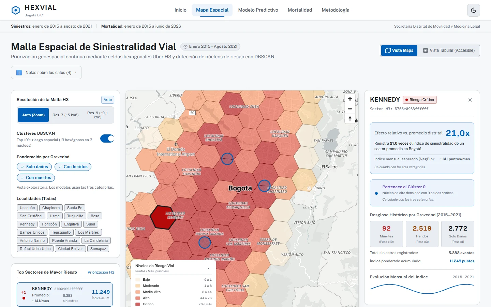
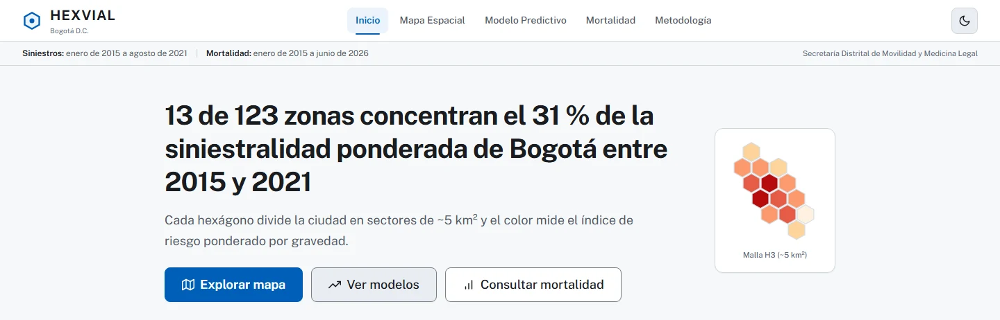
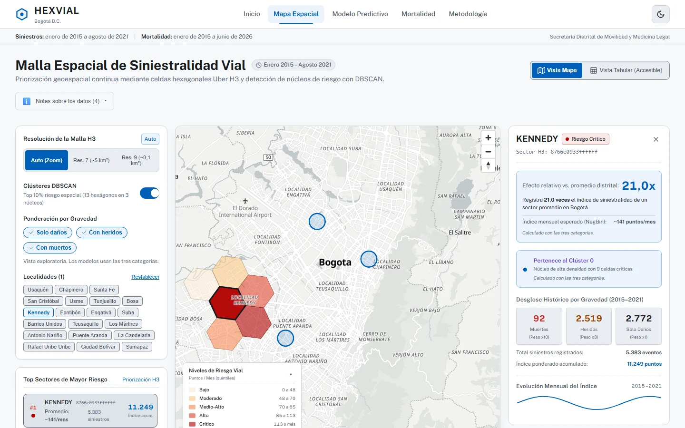
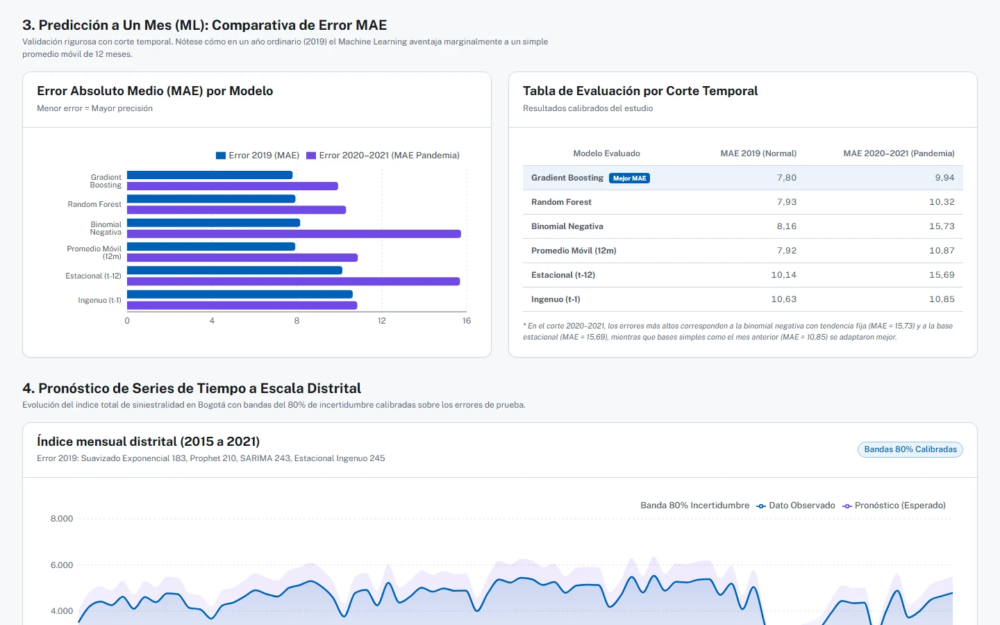
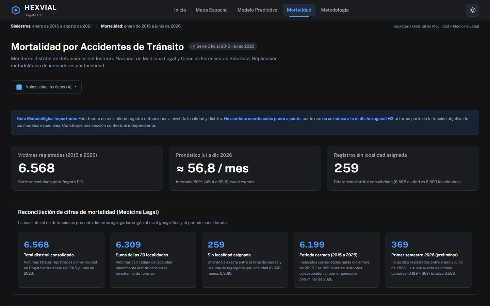
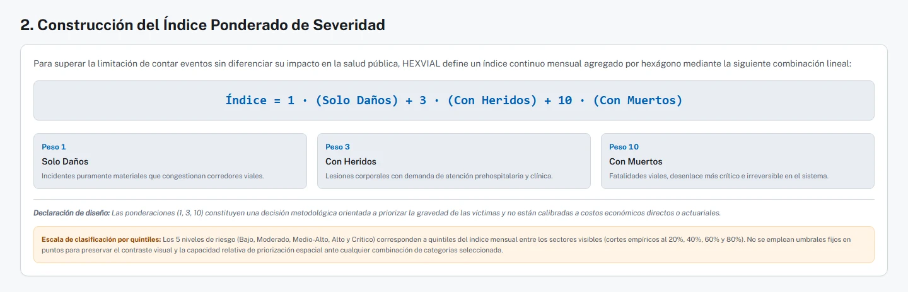

<h1 align="center">HEXVIAL</h1>

Predicción y priorización espacial de siniestralidad vial en Bogotá D.C.

<a href="https://hexvial.vercel.app">https://hexvial.vercel.app</a>

  
   
  Mapa base: OpenFreeMap © OpenMapTiles, con datos de © colaboradores de OpenStreetMap bajo la licencia ODbL.

## El problema

Bogotá registra miles de siniestros viales cada año, y los recursos para intervenir una vía son limitados. Contar choques por localidad no basta para decidir dónde actuar: una localidad mezcla corredores críticos con barrios tranquilos, y un choque con solo daños no pesa lo mismo que uno con víctimas. HEXVIAL busca responder dónde se concentra el riesgo, qué tan estable es en el tiempo y qué tan bien se puede anticipar.

## Los datos

| Fuente | Periodo analizado |
| :--- | :--- |
| Siniestros viales georreferenciados de la Secretaría Distrital de Movilidad | Enero de 2015 a agosto de 2021 |
| Mortalidad por siniestros de tránsito del Instituto Nacional de Medicina Legal, vía SaluData | Enero de 2015 a junio de 2026 |

Se analizan 198.392 siniestros de enero de 2015 a agosto de 2021. El mes de septiembre de 2021 quedó fuera porque la fuente lo publica incompleto, con solo 754 registros. La serie de mortalidad suma 6.568 víctimas, de las cuales 369 corresponden al primer semestre de 2026 y todavía son preliminares.

## El enfoque

- **Una malla de hexágonos en lugar de límites administrativos.** La ciudad se divide con el sistema H3 en 123 sectores de unos 5,16 km² cada uno. Todos tienen el mismo tamaño y la misma forma, así que los corredores viales no quedan partidos por las fronteras entre localidades.
- **Un índice que pesa la gravedad.** Cada siniestro suma 1 punto si solo hubo daños, 3 si hubo heridos y 10 si hubo muertos. Esos pesos son una decisión de diseño para dar prioridad a las víctimas, no un costo económico.
- **Un modelo de conteo con efecto propio para cada sector.** La varianza del índice es 44,89 veces su media, demasiado para un modelo de Poisson. Por eso se usa una regresión binomial negativa con un efecto fijo por sector, que mide cuánto más riesgoso es cada hexágono que el promedio de la ciudad.
- **Núcleos de concentración con DBSCAN.** Sobre el 10 % de sectores con mayor riesgo acumulado, que son 13 hexágonos, el algoritmo DBSCAN agrupa los que están a menos de 3,0 km entre sí y forma 3 núcleos.
- **Comparación honesta de modelos de predicción.** Gradient Boosting, Random Forest y la binomial negativa se comparan contra tres reglas simples: repetir el mes anterior, repetir el mismo mes del año previo y usar el promedio de los últimos 12 meses. Se entrenan con el pasado y se evalúan en 2019, un año normal, y en 2020 a 2021, con la pandemia.
- **Series de tiempo para la mortalidad.** Se comparan varios métodos de pronóstico con validación por origen móvil y se proyecta la mortalidad mensual de la ciudad para el segundo semestre de 2026.

## Lo que se encontró

1. **El riesgo está concentrado.** 13 de los 123 sectores concentran el 31 % del índice acumulado de la ciudad entre 2015 y 2021.
2. **El riesgo es estable en el espacio.** El 87,4 % de la variación del índice corresponde a diferencias fijas entre sectores. Los puntos críticos siguen en el mismo lugar año tras año.
3. **Un sector se destaca.** El sector de mayor riesgo, en Kennedy, registra 21,03 veces el índice de un sector promedio de Bogotá, con un índice esperado de unos 141 puntos por mes.
4. **La pandemia no cambió la tendencia de fondo.** Durante el cierre, el índice cayó 49,1 %, con un intervalo bootstrap del 95 % entre −57,9 % y −37,9 %. En la reapertura seguía 20,8 % por debajo, con un intervalo entre −26,8 % y −14,7 %. Una vez descontado ese efecto, la tendencia mensual estimada es de +0,37 % por mes, con un intervalo del 95 % entre +0,19 % y +0,54 %.
5. **El aprendizaje automático ayuda, pero por poco.** En 2019, Gradient Boosting obtuvo un error absoluto medio de 7,80 frente a 7,92 del promedio móvil de 12 meses. En 2020 y 2021 la diferencia fue de 9,94 frente a 10,85 del modelo que repite el mes anterior.

Para la mortalidad, el pronóstico de julio a diciembre de 2026 es de unas 56,8 muertes por mes, con un intervalo del 80 % entre 45,4 y 69,8.

## Recorrido por el sitio

  

**Inicio.** El hallazgo principal, los indicadores clave y los límites de la información.

  
   
  Mapa base: OpenFreeMap © OpenMapTiles, con datos de © colaboradores de OpenStreetMap bajo la licencia ODbL.

**Mapa espacial.** Filtros por localidad y por gravedad, núcleos DBSCAN, sectores prioritarios y el detalle de cada hexágono con su historia mensual.

  

**Modelo predictivo.** El diagnóstico estadístico, el efecto de cada sector, la comparación de errores entre modelos y el pronóstico del índice de la ciudad.

  

**Mortalidad.** La serie de víctimas fatales por ciudad y por localidad, la reconciliación de las cifras y el pronóstico para 2026.

  

**Metodología.** Las fuentes, la construcción del índice, el glosario técnico y los créditos.

## Alcance y limitaciones

Los datos con coordenadas terminan en agosto de 2021: describen la estructura histórica de la ciudad, no el tráfico de hoy ni el efecto de obras recientes. Los pesos del índice son una convención de diseño sin calibración actuarial, y el número de núcleos espaciales cambia según el esquema de pesos que se use. La serie de mortalidad no tiene coordenadas, así que no alimenta la malla de hexágonos, y sus meses más recientes son preliminares. El efecto de la pandemia se mide como una asociación a partir de fechas de cuarentena que el equipo tomó como supuesto de trabajo, no como relación causal. Los modelos no cuentan con volúmenes de tráfico ni aforos peatonales por sector.

## Validación

El 16 de noviembre de 2026 se corrió la batería de pruebas sobre el commit publicado:
- pruebas automáticas de la API: 18 de 18;
- prueba de humo contra la API en producción: 10 de 10 endpoints;
- valores de control de los reportes: 20 de 20;
- pruebas del frontend: 34 de 34;
- verificación de las cifras del sitio contra la API: 47 de 47, en un segundo intento, tras una falla del primero ajena a las cifras;
- pruebas de interacción del mapa y de ponderación: aprobadas;
- auditoría automatizada de accesibilidad: sin violaciones en 20 configuraciones.

El detalle, con los criterios y los intentos fallidos, está en [pruebas_resultado.md](pruebas_resultado.md).

Los reportes de análisis están en [reportes/](reportes/) y el esquema de los datos que sirve la API, en [ESQUEMA.md](datos/procesados/api/ESQUEMA.md).

## Créditos

**Autores**

- Daniel Andrés Jiménez Povea
- Josué David Morelo Castro
- Jostin Andrés Colón Ramos
- Antonio De Jesús Márquez Vásquez

Proyecto académico. Datos abiertos de la Secretaría Distrital de Movilidad de Bogotá y del Instituto Nacional de Medicina Legal vía SaluData.

**Fuentes de datos, consultadas el 16 de noviembre de 2026**

| Conjunto de datos | Responsable | Licencia |
| :--- | :--- | :--- |
| [Histórico Siniestros Bogotá D.C.](https://datosabiertos.bogota.gov.co/dataset/historico-siniestros-bogota-d-c) | Secretaría Distrital de Movilidad, publicado en Datos Abiertos Bogotá | [CC BY 4.0](https://creativecommons.org/licenses/by/4.0/), según la [copia archivada de la ficha oficial del 14-11-2023](https://web.archive.org/web/20231114181142/https://datosabiertos.bogota.gov.co/dataset/historico-siniestros-bogota-d-c). El conjunto ya no está disponible en el portal; la licencia se tomó de la copia archivada de su ficha oficial. |
| [Mortalidad por accidentes de tránsito](https://datosabiertos.bogota.gov.co/dataset/mortalidad-por-accidentes-de-transito) | Secretaría Distrital de Salud, Observatorio de Salud de Bogotá, [SaluData](https://saludata.saludcapital.gov.co/osb/indicadores/mortalidad-de-accidentes-de-transito/), con datos del Instituto Nacional de Medicina Legal y Ciencias Forenses | [CC BY 4.0](https://creativecommons.org/licenses/by/4.0/) |

Los datos se usaron depurados, agregados por sector y mes, y transformados en índices y modelos. Cita sugerida por la fuente: Secretaría Distrital de Salud. Observatorio de Salud de Bogotá-SaluData. Disponible en [https://saludata.saludcapital.gov.co/osb/](https://saludata.saludcapital.gov.co/osb/)

**Mapa base**

- Datos cartográficos © [colaboradores de OpenStreetMap](https://www.openstreetmap.org/copyright), disponibles bajo la [Open Database License, ODbL](https://opendatacommons.org/licenses/odbl/).
- Teselas y estilos de [OpenFreeMap](https://openfreemap.org) © [OpenMapTiles](https://www.openmaptiles.org/).

**Software y servicios**

| Nombre | Licencia | Enlace |
| :--- | :--- | :--- |
| H3 y h3-js | Apache-2.0 | [github.com/uber/h3](https://github.com/uber/h3) |
| MapLibre GL JS | BSD-3-Clause | [github.com/maplibre/maplibre-gl-js](https://github.com/maplibre/maplibre-gl-js) |
| React | MIT | [github.com/facebook/react](https://github.com/facebook/react) |
| React Router | MIT | [github.com/remix-run/react-router](https://github.com/remix-run/react-router) |
| Vite | MIT | [github.com/vitejs/vite](https://github.com/vitejs/vite) |
| TypeScript | Apache-2.0 | [github.com/microsoft/TypeScript](https://github.com/microsoft/TypeScript) |
| TanStack Query | MIT | [github.com/TanStack/query](https://github.com/TanStack/query) |
| Recharts | MIT | [github.com/recharts/recharts](https://github.com/recharts/recharts) |
| Zustand | MIT | [github.com/pmndrs/zustand](https://github.com/pmndrs/zustand) |
| Radix UI Primitives | MIT | [github.com/radix-ui/primitives](https://github.com/radix-ui/primitives) |
| FastAPI | MIT | [github.com/fastapi/fastapi](https://github.com/fastapi/fastapi) |
| Pydantic | MIT | [github.com/pydantic/pydantic](https://github.com/pydantic/pydantic) |
| Uvicorn | BSD-3-Clause | [github.com/Kludex/uvicorn](https://github.com/Kludex/uvicorn) |
| pandas | BSD-3-Clause | [github.com/pandas-dev/pandas](https://github.com/pandas-dev/pandas) |
| NumPy | BSD-3-Clause, con componentes bajo 0BSD, MIT, Zlib y CC0-1.0 | [github.com/numpy/numpy](https://github.com/numpy/numpy) |
| PyArrow, de Apache Arrow | Apache-2.0 | [github.com/apache/arrow](https://github.com/apache/arrow) |
| statsmodels | BSD-3-Clause | [github.com/statsmodels/statsmodels](https://github.com/statsmodels/statsmodels) |
| scikit-learn | BSD-3-Clause | [github.com/scikit-learn/scikit-learn](https://github.com/scikit-learn/scikit-learn) |
| Prophet | MIT | [github.com/facebook/prophet](https://github.com/facebook/prophet) |
| SciPy | BSD-3-Clause | [github.com/scipy/scipy](https://github.com/scipy/scipy) |
| Matplotlib | Licencia de Matplotlib, basada en la PSF | [matplotlib.org/stable/project/license.html](https://matplotlib.org/stable/project/license.html) |
| joblib | BSD-3-Clause | [github.com/joblib/joblib](https://github.com/joblib/joblib) |
| Vercel, alojamiento del sitio | Servicio con términos de uso | [vercel.com/legal/terms](https://vercel.com/legal/terms) |
| Render, alojamiento de la API | Servicio con términos de uso | [render.com/terms](https://render.com/terms) |

## Derechos

[© 2026 Jiménez, Morelo, Colón y Márquez. Todos los derechos reservados.](LICENCIA.md)

Los datos pertenecen a sus fuentes y se usan según sus términos. El código fuente del proyecto se mantiene en un repositorio privado.
