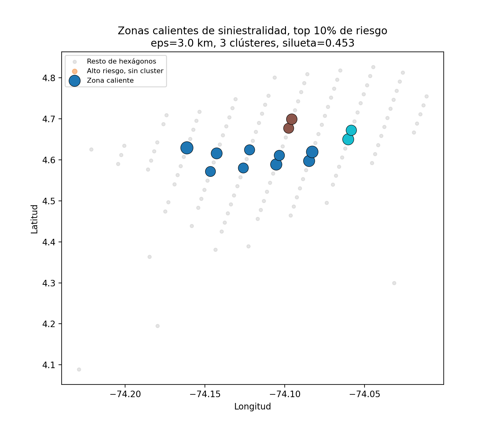

# Clustering espacial de zonas calientes

Hexágonos totales: 123. Hexágonos en el top 10% de riesgo: 13.

Mejor configuración: eps = 3.0 km, 3 clústeres, silueta = 0.453.

## Clústeres encontrados

 cluster  hexagonos  indice_total      lat        lon
       0          9         80217 4.604031 -74.119433
       2          2         17199 4.660926 -74.059271
       1          2         16030 4.687984 -74.096583

Nota: este clustering corre solo sobre el subconjunto de mayor riesgo, no sobre todos los hexágonos de la ciudad. Correrlo sobre todos los hexágonos por igual, en una ciudad densa y contigua como Bogotá, junta casi todo en un solo bloque y no aporta zonas puntuales útiles para priorización.
