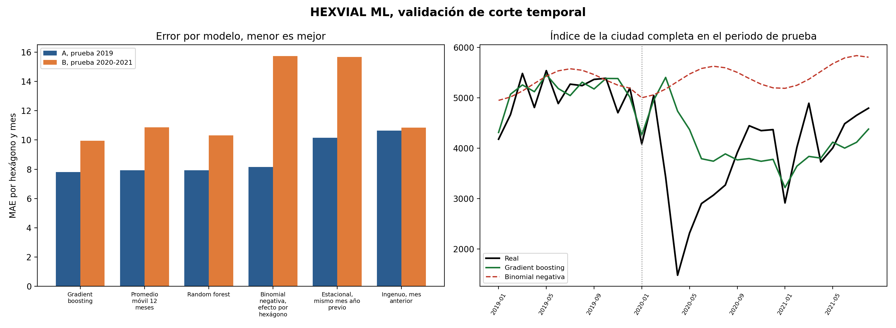

# Modelo de ML supervisado, validación de corte temporal

Panel: 8364 filas, 123 hexágonos, de 2016-01 a 2021-08. Mes parcial 2021-09 excluido por ser incompleto.

## Corte A, prueba 2019

                                modelo    MAE   RMSE  WAPE  MAPE ciudad  Aciertos top 13  Spearman hexágonos
                     Gradient boosting  7.801 12.401 0.190        0.048               11               0.994
               Promedio móvil 12 meses  7.925 12.682 0.193        0.073               12               0.996
                         Random forest  7.933 12.545 0.193        0.061               12               0.994
Binomial negativa, efecto por hexágono  8.156 12.876 0.198        0.069               11               0.990
      Estacional, mismo mes año previo 10.142 16.104 0.247        0.049               11               0.990
                 Ingenuo, mes anterior 10.631 17.038 0.259        0.103               12               0.999

Importancia por permutación, gradient boosting, corte A, prueba 2019

    variable  importancia
   media_12m       20.045
    media_6m        8.756
         lat        1.499
        lag1        1.265
vecinos_lag1        0.941
        lag3        0.851
     mes_cos        0.341
       lag12        0.310
        lag2        0.263
    media_3m        0.238
     mes_sin        0.100
         lon        0.078
muertos_lag1       -0.002

## Corte B, prueba 2020-2021

                                modelo    MAE   RMSE  WAPE  MAPE ciudad  Aciertos top 13  Spearman hexágonos
                     Gradient boosting  9.942 16.959 0.321        0.284               12               0.989
                         Random forest 10.317 17.598 0.333        0.311               12               0.992
                 Ingenuo, mes anterior 10.845 17.950 0.350        0.237               13               0.996
               Promedio móvil 12 meses 10.870 18.499 0.351        0.346               12               0.991
      Estacional, mismo mes año previo 15.686 25.855 0.507        0.510               10               0.981
Binomial negativa, efecto por hexágono 15.735 25.909 0.508        0.551                8               0.974

Importancia por permutación, gradient boosting, corte B, prueba 2020-2021

    variable  importancia
   media_12m       12.746
    media_6m        3.053
         lat        1.033
    media_3m        0.955
vecinos_lag1        0.577
        lag1        0.276
     mes_cos        0.177
     mes_sin        0.130
        lag2        0.049
        lag3        0.044
         lon        0.006
muertos_lag1        0.003
       lag12       -0.080

Las predicciones son de un mes adelante, usando los valores reales de los meses anteriores. No son pronósticos de varios meses hacia el futuro. Las predicciones de ambos cortes quedan en datos/procesados/variables/predicciones_supervisado.
