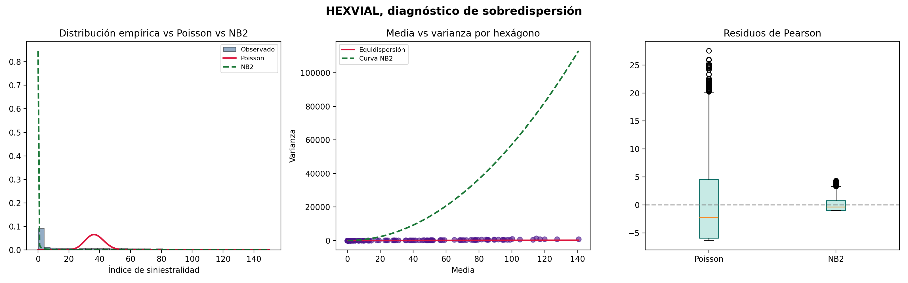

# Diagnóstico de sobredispersión

Observaciones: 9840, hexágonos: 123, periodos: 80

## Resultados

- Razón varianza/media: 44.89
- Phi de Pearson, Poisson GLM: 44.77
- Dean & Lawless: T=113348.3, p=0.00e+00
- Cameron & Trivedi: alpha=43.750, p=0.00e+00
- Vuong: V=-107.17, p=0.00e+00
- AIC Poisson: 507286.4, AIC NB2: 90892.6, delta AIC: 416393.8
- ICC entre hexágonos: 0.874

## Veredicto

5/5 tests favorecen binomial negativa sobre Poisson. Usar BINOMIAL NEGATIVA como familia del GLM.

La heterogeneidad entre hexágonos, ICC = 0.874, es alta. Dado que son 123 hexágonos distintos, la forma correcta de absorber esa heterogeneidad en la regresión es con efecto fijo o aleatorio por hexágono, no con una etiqueta de clúster de solo 2 o 3 categorías, que perdería la mayor parte de esa variación. El clustering espacial se trabaja aparte, en agrupamiento_espacial.py, como insumo para el mapa de priorización, no como covariable de este modelo.
