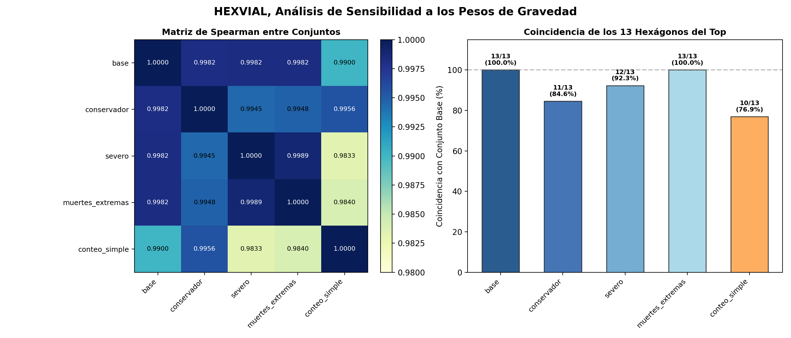

# Análisis de Sensibilidad: Ponderación del Índice de Gravedad

Evaluación de la variación en rankings, homogeneidad espacial y agrupamiento 
bajo cinco esquemas de ponderación de gravedad vial en Bogotá.

## 1. Definición de Conjuntos de Ponderación Evaluados

| Conjunto | Solo Daños | Con Heridos | Con Muertos | Participación Muertos (%) |
| :--- | :---: | :---: | :---: | :---: |
| `base` | 1 | 3 | 10 | 8.91% |
| `conservador` | 1 | 2 | 5 | 5.79% |
| `severo` | 1 | 5 | 20 | 12.20% |
| `muertes_extremas` | 1 | 3 | 30 | 22.70% |
| `conteo_simple` | 1 | 1 | 1 | 1.63% |

## 2. Resumen Comparativo de Métricas Frente al Conjunto Base

| Conjunto | Spearman Rank | Kendall Tau | Top 13 Prop. | Top 13 Jaccard | Top 25 Prop. | Top 25 Jaccard | ICC | DBSCAN eps (km) | Clústeres | Silueta | Jaccard Alto Riesgo | Corr. Mensual Pearson | Corr. Mensual Spearman |
| :--- | :---: | :---: | :---: | :---: | :---: | :---: | :---: | :---: | :---: | :---: | :---: | :---: | :---: |
| `base` | 1.0000 | 1.0000 | 1.0000 | 1.0000 | 1.0000 | 1.0000 | 0.8739 | 3.0 | 3 | 0.4531 | 1.0000 | 1.0000 | 1.0000 |
| `conservador` | 0.9982 | 0.9754 | 0.8462 | 0.7333 | 0.9600 | 0.9231 | 0.8813 | 3.0 | 2 | 0.2534 | 0.7333 | 0.9965 | 0.9915 |
| `severo` | 0.9982 | 0.9717 | 0.9231 | 0.8571 | 0.9600 | 0.9231 | 0.8592 | 3.0 | 2 | 0.3378 | 0.8571 | 0.9955 | 0.9897 |
| `muertes_extremas` | 0.9982 | 0.9721 | 1.0000 | 1.0000 | 0.9200 | 0.8519 | 0.8031 | 3.0 | 3 | 0.4531 | 1.0000 | 0.9894 | 0.9745 |
| `conteo_simple` | 0.9900 | 0.9274 | 0.7692 | 0.6250 | 0.8400 | 0.7241 | 0.8779 | 2.5 | 3 | 0.4659 | 0.6250 | 0.9763 | 0.9528 |

## 3. Matriz de Correlación de Spearman entre Conjuntos

|                  |   base |   conservador |   severo |   muertes_extremas |   conteo_simple |
|:-----------------|-------:|--------------:|---------:|-------------------:|----------------:|
| base             | 1      |        0.9982 |   0.9982 |             0.9982 |          0.99   |
| conservador      | 0.9982 |        1      |   0.9945 |             0.9948 |          0.9956 |
| severo           | 0.9982 |        0.9945 |   1      |             0.9989 |          0.9833 |
| muertes_extremas | 0.9982 |        0.9948 |   0.9989 |             1      |          0.984  |
| conteo_simple    | 0.99   |        0.9956 |   0.9833 |             0.984  |          1      |

## 4. Matriz de Tau de Kendall entre Conjuntos

|                  |   base |   conservador |   severo |   muertes_extremas |   conteo_simple |
|:-----------------|-------:|--------------:|---------:|-------------------:|----------------:|
| base             | 1      |        0.9754 |   0.9717 |             0.9721 |          0.9274 |
| conservador      | 0.9754 |        1      |   0.9459 |             0.9482 |          0.953  |
| severo           | 0.9717 |        0.9459 |   1      |             0.9798 |          0.8979 |
| muertes_extremas | 0.9721 |        0.9482 |   0.9798 |             1      |          0.9039 |
| conteo_simple    | 0.9274 |        0.953  |   0.8979 |             0.9039 |          1      |

## 5. Ranking de los 13 Hexágonos del Top por Conjunto

|   puesto | base                     | conservador             | severo                   | muertes_extremas         | conteo_simple           |
|---------:|:-------------------------|:------------------------|:-------------------------|:-------------------------|:------------------------|
|        1 | 8766e0933ffffff (11,249) | 8766e0933ffffff (8,270) | 8766e0933ffffff (17,207) | 8766e0933ffffff (13,089) | 8766e092effffff (5,722) |
|        2 | 8766e092effffff (10,199) | 8766e092effffff (7,913) | 8766e092effffff (14,771) | 8766e092effffff (12,099) | 8766e42d2ffffff (5,499) |
|        3 | 8766e0901ffffff (9,586)  | 8766e42d2ffffff (7,313) | 8766e0901ffffff (14,548) | 8766e092affffff (11,486) | 8766e0933ffffff (5,383) |
|        4 | 8766e092affffff (9,366)  | 8766e0901ffffff (7,105) | 8766e092affffff (14,284) | 8766e0901ffffff (11,306) | 8766e42d6ffffff (5,334) |
|        5 | 8766e42d2ffffff (9,185)  | 8766e092affffff (6,907) | 8766e0906ffffff (13,715) | 8766e0906ffffff (11,259) | 8766e428affffff (4,981) |
|        6 | 8766e0906ffffff (9,019)  | 8766e0906ffffff (6,671) | 8766e42d2ffffff (12,929) | 8766e42d2ffffff (10,345) | 8766e0922ffffff (4,832) |
|        7 | 8766e428affffff (8,393)  | 8766e428affffff (6,657) | 8766e428affffff (11,865) | 8766e428affffff (9,593)  | 8766e0901ffffff (4,710) |
|        8 | 8766e42d6ffffff (8,014)  | 8766e42d6ffffff (6,656) | 8766e091cffffff (11,727) | 8766e091cffffff (9,485)  | 8766e092affffff (4,554) |
|        9 | 8766e0905ffffff (7,907)  | 8766e0905ffffff (6,085) | 8766e0903ffffff (11,685) | 8766e0905ffffff (9,387)  | 8766e0926ffffff (4,537) |
|       10 | 8766e0904ffffff (7,789)  | 8766e0922ffffff (6,061) | 8766e0905ffffff (11,551) | 8766e0924ffffff (9,057)  | 8766e0906ffffff (4,435) |
|       11 | 8766e0924ffffff (7,637)  | 8766e0904ffffff (6,009) | 8766e0904ffffff (11,349) | 8766e0903ffffff (9,017)  | 8766e4289ffffff (4,427) |
|       12 | 8766e0903ffffff (7,557)  | 8766e0924ffffff (5,955) | 8766e0914ffffff (11,157) | 8766e0904ffffff (9,009)  | 8766e0924ffffff (4,344) |
|       13 | 8766e091cffffff (7,545)  | 8766e0926ffffff (5,811) | 8766e0924ffffff (11,001) | 8766e42d6ffffff (8,734)  | 8766e0905ffffff (4,337) |

## 6. Validación de Reproducción del Conjunto Base

- Coincidencia exacta de índices acumulados por hexágono frente a riesgo_por_sector: Sí (diferencia máxima = 0.0).
- Coincidencia exacta del conjunto top 13 frente a agrupamiento_espacial: Sí (13/13).
- Parámetros DBSCAN reproducidos exactamente: eps = 3.0 km, 3 clústeres, silueta = 0.453.
- Estado de validación formal: VERIFICACIÓN EXITOSA.
