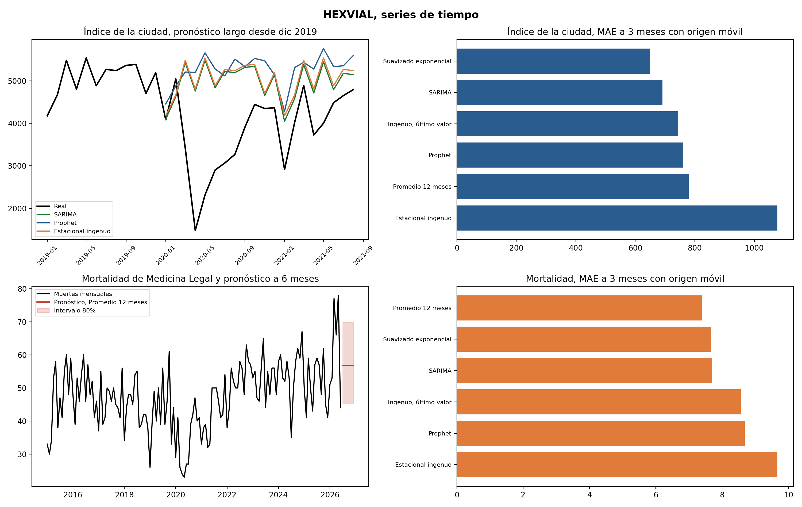

# Series de tiempo

Índice de la ciudad: 2015-01 a 2021-08. Mortalidad: 2015-01 a 2026-06. Registros de mortalidad sin mes descartados: 1.

## Serie: indice

Orden SARIMA elegido con datos hasta 2018-12: (1, 1, 1) x (0, 1, 1, 12).

### Corte largo A, prueba 2019, 12 meses de prueba

               modelo     MAE    RMSE  MAPE
Suavizado exponencial 183.330 248.605 0.038
              Prophet 210.083 255.570 0.043
               SARIMA 242.662 306.511 0.050
   Estacional ingenuo 245.250 304.853 0.049
Ingenuo, último valor 331.750 398.900 0.069
    Promedio 12 meses 342.000 393.207 0.070

### Corte largo B, prueba 2020-2021, 20 meses de prueba

               modelo      MAE     RMSE  MAPE
               SARIMA 1204.784 1516.910 0.427
    Promedio 12 meses 1252.333 1543.644 0.447
   Estacional ingenuo 1269.700 1564.463 0.445
Ingenuo, último valor 1385.750 1653.723 0.485
Suavizado exponencial 1430.446 1700.173 0.494
              Prophet 1466.431 1725.054 0.504

### Origen móvil, 3 meses adelante, 30 orígenes

               modelo      MAE  MAE h=1  MAE h=2  MAE h=3  gana a estacional, % origenes
Suavizado exponencial  648.948  482.466  684.332  780.047                          0.767
               SARIMA  691.644  522.994  729.565  822.371                          0.633
Ingenuo, último valor  744.278  670.533  709.400  852.900                          0.600
              Prophet  761.344  743.174  760.503  780.356                          0.733
    Promedio 12 meses  779.556  740.031  773.769  824.869                          0.667
   Estacional ingenuo 1077.967 1031.100 1077.967 1124.833                          0.000

## Serie: mortalidad

Orden SARIMA elegido con datos hasta 2018-12: (1, 0, 1) x (1, 0, 0, 12).

### Corte largo A, prueba 2019, 12 meses de prueba

               modelo   MAE   RMSE  MAPE
              Prophet 6.801  7.935 0.166
   Estacional ingenuo 7.000  8.775 0.169
Suavizado exponencial 7.318  8.268 0.188
    Promedio 12 meses 7.417  9.239 0.186
               SARIMA 7.599  9.516 0.182
Ingenuo, último valor 8.417 10.790 0.186

### Corte largo B, prueba 2020-2021, 24 meses de prueba

               modelo    MAE   RMSE  MAPE
Suavizado exponencial  8.071 10.890 0.268
              Prophet  8.074 10.054 0.254
    Promedio 12 meses  8.458 10.404 0.273
Ingenuo, último valor  8.667 10.630 0.281
               SARIMA  9.999 12.042 0.299
   Estacional ingenuo 10.417 13.140 0.323

### Corte largo C, prueba 2024, 12 meses de prueba

               modelo   MAE   RMSE  MAPE
    Promedio 12 meses 6.375  8.210 0.123
               SARIMA 6.882  8.524 0.129
   Estacional ingenuo 7.333  8.573 0.135
              Prophet 7.917  9.418 0.154
Suavizado exponencial 8.064  9.577 0.153
Ingenuo, último valor 9.583 10.650 0.174

### Origen móvil, 3 meses adelante, 88 orígenes

               modelo   MAE  MAE h=1  MAE h=2  MAE h=3  gana a estacional, % origenes
    Promedio 12 meses 7.395    7.159    7.390    7.634                          0.739
Suavizado exponencial 7.668    7.181    7.729    8.093                          0.750
               SARIMA 7.684    7.358    7.762    7.932                          0.727
Ingenuo, último valor 8.561    8.205    8.477    9.000                          0.591
              Prophet 8.685    8.501    8.591    8.963                          0.636
   Estacional ingenuo 9.670    9.432    9.739    9.841                          0.000

## Pronóstico de mortalidad a 6 meses

Modelo: Promedio 12 meses, el de menor error en el origen móvil. Las diferencias entre los tres mejores son pequeñas, así que la elección no es concluyente.

El intervalo teórico del 80 por ciento de SARIMA cubre en la práctica solo 70.1% de los casos, por eso el intervalo mostrado se calibra con los percentiles 10 y 90 de los errores reales del modelo en la validación, pooled de 1 a 3 meses. Para horizontes de 4 a 6 meses es una aproximación, el error real puede ser algo mayor.

            prediccion  inferior  superior
2026-07-01        56.8      45.4      69.8
2026-08-01        56.8      45.4      69.8
2026-09-01        56.8      45.4      69.8
2026-10-01        56.8      45.4      69.8
2026-11-01        56.8      45.4      69.8
2026-12-01        56.8      45.4      69.8

Los últimos meses de la serie de mortalidad son preliminares y pueden estar subregistrados hasta que se consoliden, lo que sesgaría el pronóstico a la baja.
